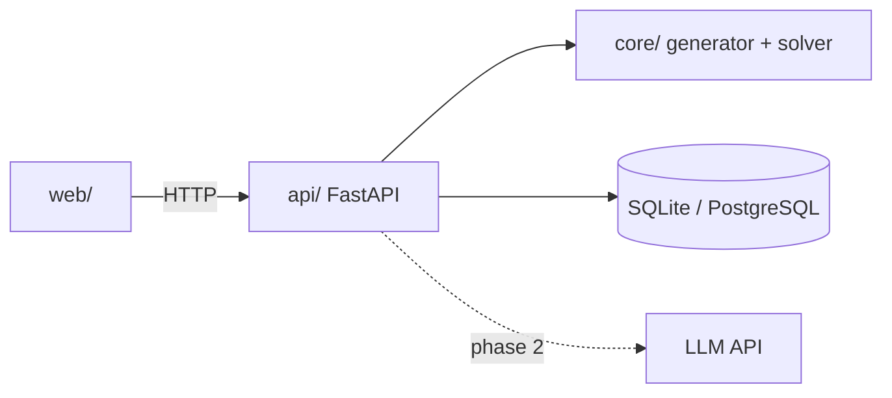

# Стек и архитектура

## Стек

| Часть | Технология | Статус |
|---|---|---|
| Ядро | Python 3.12+, pytest | выбрано |
| Backend | FastAPI | выбрано |
| БД | SQLite на старте, потом PostgreSQL | выбрано |
| Frontend | React или серверные шаблоны | не решено |
| Деплой | Docker + недорогой VPS | выбрано |
| ИИ (фаза 2) | LLM через API поверх ядра | не в MVP |

## Модули

- `lingpuzzle.core` (`src/lingpuzzle/core/`) не знает про веб и БД.
- `api/` выдаёт задачу, принимает ответ, засекает время, ведёт рейтинг.

## Почему ядро без LLM

- Нейросеть не гарантирует единственность решения.
- LLM плохо решают такие задачи: бенчмарк LingOly (NeurIPS 2024), лучшая модель на сложных задачах — 38,7%.
- Аналогия — генератор судоку: он проверяет, что решение ровно одно.
- Вычисления небольшие: миллисекунды-секунды на MacBook Air M5, GPU не нужен.

## Агенты харнесса

| Агент | Роль |
|---|---|
| planner, skeptic | план фичи и его критика (`/plan`) |
| python-core | пишет `src/lingpuzzle/core/**`, `tests/core/**`, `pyproject.toml`, `.github/workflows/**` (`/build`) |
| reviewer | ревью диффа против плана (`/review`, включает `/mutation`) |
| debugger | поиск причины бага с красным тестом (`/debug`) |

Тесты: `.venv/bin/python -m pytest -q` (`.claude/harness/quality.json`). Хук Verify гоняет их после каждой правки кода.
